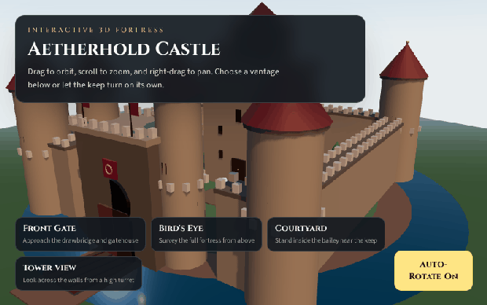

# Aetherhold Castle

An interactive, production-ready 3D medieval castle viewer. Orbit, pan, and zoom a procedurally built fortress, jump to cinematic camera angles, or let the keep auto-rotate at sunset.

## Tech Stack Used

- React 19
- Vite 8
- Tailwind CSS 4
- Three.js
- @react-three/fiber
- @react-three/drei
- GSAP (camera preset animations)

Generation model: `monkeycode-pro/grok-4.6`

## Preview



## Prerequisites & Installation Instructions

- Node.js 18 or newer
- npm 10 or newer

Install dependencies:

```bash
npm install
```

## Running the Development Server

```bash
npm run dev
```

Then open the local URL printed in the terminal (typically `http://localhost:5173`).

Production build:

```bash
npm run build
```

Preview the production build:

```bash
npm run preview
```

## Features & Controls Overview

- Procedural medieval castle: keep, cylindrical towers with conical roofs, curtain walls, battlements, gatehouse, drawbridge, moat, and courtyard details
- PBR-style `MeshStandardMaterial` surfaces with stone, timber, roof tile, water, and gold accents
- Warm directional sunlight, ambient fill, hemisphere light, torch-like point lights, and real-time shadows
- OrbitControls: left-drag rotate, scroll zoom, right-drag pan (touch supported)
- Preset viewpoints with GSAP camera animation: Front Gate, Bird's Eye, Courtyard, Tower View
- Auto-rotate toggle for a slow, continuous orbit
- Overlay UI for camera presets and rotation control

## Project Structure Breakdown

```text
.
├── index.html
├── package.json
├── vite.config.js
├── README.md
├── public/
└── src/
    ├── main-grok4.6.jsx
    ├── App-grok4.6.jsx
    ├── index-grok4.6.css
    ├── generated-by-grok4.6.js
    ├── data/
    │   └── cameraPresets-grok4.6.js
    └── components/
        ├── Scene-grok4.6.jsx
        ├── Castle-grok4.6.jsx
        ├── Lighting-grok4.6.jsx
        ├── Controls-grok4.6.jsx
        └── UIOverlay-grok4.6.jsx
```

- `src/App-grok4.6.jsx` — application shell, auto-rotate state, and camera preset selection
- `src/components/Scene-grok4.6.jsx` — Canvas, sky, environment, fog, and scene composition
- `src/components/Castle-grok4.6.jsx` — procedural keep, towers, walls, gatehouse, moat, and terrain
- `src/components/Lighting-grok4.6.jsx` — sun, fill, ambient, and accent lights
- `src/components/Controls-grok4.6.jsx` — OrbitControls plus GSAP camera transitions
- `src/components/UIOverlay-grok4.6.jsx` — floating HUD for presets and auto-rotate
- `src/data/cameraPresets-grok4.6.js` — named viewpoints and look-at targets
- `src/generated-by-grok4.6.js` — generation model identifier
