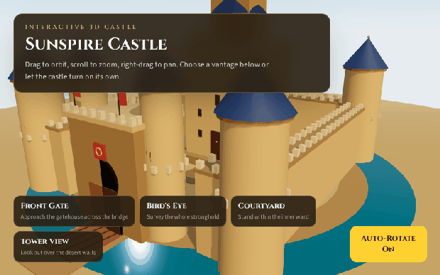

# Sunspire Castle

An interactive, production-ready 3D medieval castle viewer. Orbit, pan, and zoom a procedurally generated desert fortress, fly the camera to cinematic viewpoints with smooth GSAP animations, or let the castle auto-rotate.

## Project Title & Short Description

**Sunspire Castle** is a single-page React application that renders a detailed procedural medieval castle in the browser using WebGL. It uses `@react-three/fiber` and `@react-three/drei` for declarative 3D rendering, GSAP for camera animations, and Tailwind CSS for a clean floating control overlay.

Generation model: `monkeycode-basic/qwen3.5-plus`

## Preview



## Tech Stack Used

- React 19
- Vite 8
- Tailwind CSS 4
- Three.js
- @react-three/fiber
- @react-three/drei (OrbitControls, Sky, Environment, ContactShadows)
- GSAP (camera preset animation)

## Prerequisites & Installation Instructions

- Node.js 18 or newer
- npm 10 or newer

Install dependencies:

```bash
npm install
```

## Running the Development Server

```bash
npm run dev
```

Then open the URL printed in the terminal (typically `http://localhost:5173`).

Build for production:

```bash
npm run build
```

Preview the production build:

```bash
npm run preview
```

## Features & Controls Overview

- **Procedural castle:** main keep with a spire, four cylindrical corner towers with conical roofs, curtain walls, crenellated battlements, a twin-tower gatehouse, a drawbridge, a turquoise moat, and courtyard structures
- **PBR materials:** `MeshStandardMaterial` with tuned roughness and metalness for sandstone, timber, deep-blue roof tiles, oasis water, and gold accents
- **Dynamic lighting:** warm directional sun with real-time shadows, soft ambient and hemisphere fill, plus warm accent point lights
- **OrbitControls:** left-drag rotate, scroll to zoom, right-drag to pan (mouse and touch supported)
- **Preset viewpoints** animated with GSAP: Front Gate, Bird's Eye, Courtyard, Tower View
- **Auto-rotate toggle** for a graceful continuous orbit
- **Animated banners** that ripple on a gentle sine wave

### Camera Controls

- Left-drag: orbit the castle
- Scroll / pinch: zoom in and out
- Right-drag / two-finger drag: pan
- Preset buttons: fly the camera to a specific vista
- Auto-Rotate: toggle continuous rotation

## Project Structure Breakdown

```text
castle-qwen-3.5-plus/
├── index.html
├── package.json
├── vite.config.js
├── README.md
├── public/
└── src/
    ├── main-qwen-3.5-plus.jsx
    ├── App-qwen-3.5-plus.jsx
    ├── index-qwen-3.5-plus.css
    ├── generated-by-qwen-3.5-plus.js
    ├── data/
    │   └── cameraPresets-qwen-3.5-plus.js
    └── components/
        ├── Scene-qwen-3.5-plus.jsx
        ├── Castle-qwen-3.5-plus.jsx
        ├── Lighting-qwen-3.5-plus.jsx
        ├── Controls-qwen-3.5-plus.jsx
        └── UIOverlay-qwen-3.5-plus.jsx
```

- `src/App-qwen-3.5-plus.jsx` — application shell, auto-rotate state, and camera preset selection
- `src/components/Scene-qwen-3.5-plus.jsx` — Canvas, sky, environment, fog, and scene composition
- `src/components/Castle-qwen-3.5-plus.jsx` — procedural keep, towers, walls, gatehouse, moat, and terrain
- `src/components/Lighting-qwen-3.5-plus.jsx` — sun, fill, ambient, and accent lights
- `src/components/Controls-qwen-3.5-plus.jsx` — OrbitControls plus GSAP camera transitions
- `src/components/UIOverlay-qwen-3.5-plus.jsx` — floating HUD for presets and auto-rotate
- `src/data/cameraPresets-qwen-3.5-plus.js` — named viewpoints and look-at targets
- `src/generated-by-qwen-3.5-plus.js` — generation model identifier
